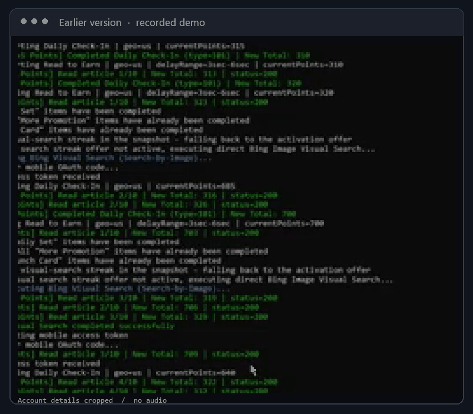

# Microsoft Rewards Script

A small TypeScript project for automating Microsoft Rewards activities in a browser. This is a fork of [TheNetsky/Microsoft-Rewards-Script](https://github.com/TheNetsky/Microsoft-Rewards-Script), with Discord integration and the separate website removed.

## Video



[Watch the full video](docs/showcase-redacted.mp4)

This recording is from an earlier version. It's cropped and blurred to hide account details, and the audio has been removed. It doesn't show this build.

## What it does

The script is designed to:

- Run Bing searches on desktop and mobile.
- Try daily tasks and other available Rewards activities.
- Show progress in the terminal.
- Use settings from a config file.

Some activities may not be available on every account, and Microsoft can change how they work. This version has not been tested with a live account.

## How many points?

There is no guaranteed amount. Available points and daily limits depend on your country, account and current offers. See [Microsoft's points guide](https://support.microsoft.com/en-us/accounts-billing/rewards/how-to-earn-microsoft-rewards-points).

**Automated searches are against Microsoft's rules.** They may earn no points and can lead to account restrictions or lost points.

## Getting started

You'll need [Node.js 24 or newer](https://nodejs.org/). Open a terminal in the project folder and run:

```sh
npm ci
npm run install:browser
npm run build
```

Copy `config.example.json` to `config.json`. Then create a file called `.env` in the project folder:

```dotenv
ACCOUNT_1_EMAIL=your@email.com
ACCOUNT_1_PASSWORD=your_password
```

Start the script with:

```sh
npm start
```

Your `.env`, config and browser sessions are ignored by Git. Keep them private. More options are documented in the [original project](https://github.com/TheNetsky/Microsoft-Rewards-Script).

## About this version

The runnable code comes from the upstream 4.1.0 version. The files in [`recovered-source/`](recovered-source/) were found in an older Antigravity project history; they're kept for reference and aren't part of the build. The TypeScript build passes on Node 24, but this copy hasn't been tested with a live account.

## License

[GPL-3.0-or-later](LICENSE). Original project by Netsky and contributors.
